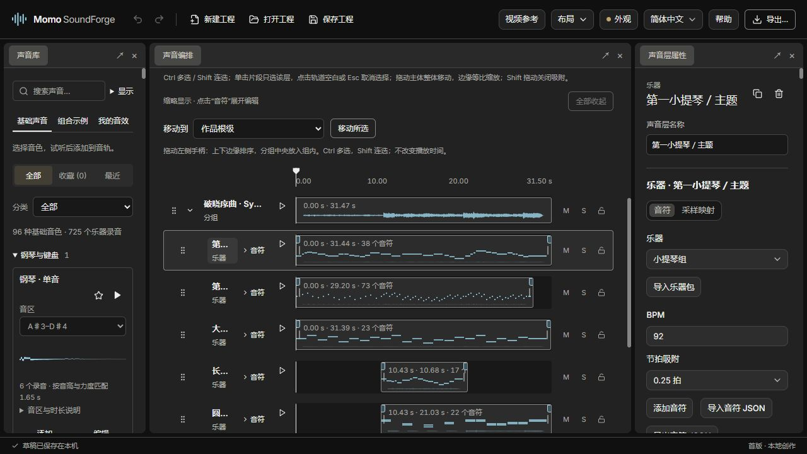

# Momo Sound Forge

<!-- doc-language -->
[简体中文](README.md) · [English](README.en.md)
<!-- /doc-language -->

Create game sound effects and short melodies in your browser: choose sounds, layer tracks, edit notes and export audio for your game. Start with audible presets and editable examples, then refine the details as you learn.

**[Use online (GitHub Pages)](https://breezymomo.github.io/MomoSoundForge/) · [User guide](docs/user-guide.en.md) · [Instruments and notes (Chinese)](docs/instruments.md) · [Development and deployment](docs/development.md)**

No account is required. Synthesis, mixing and export run on your device. Factory sounds download on demand; imported audio, video and personal projects are not uploaded. Drafts and My sounds stay in the current browser. Download project files to back up or transfer your work.



> Choose sounds on the left, arrange and audition in the center, and edit notes and parameters on the right. Screenshot shows the Chinese UI; English is available in the toolbar.

## What you can create

- **Game effects:** confirm, deny, pickup, impact, laser, charge, whoosh and explosion presets, plus recorded impacts, liquids, cloth and other sounds.
- **A basic sound library:** 115 choices covering 48 instrument/articulation combinations, 59 CC0 sound-effect groups and eight synth presets. Instruments use 725 distinct recordings and effects use 106, with search, audition, favorites, range and recording selection.
- **Instrument parts:** piano, strings, woodwinds, brass and percussion. Edit pitch, beat timing and velocity, with sample mappings for ranges, dynamics and articulations.
- **Multitrack arrangement:** move selected tracks together, resize, crop non-destructively, fade, mute and solo. Compact note contours expand into an editable piano roll.
- **Compositions and reuse:** groups, nested projects, editable examples, a local library and macro controls that adjust several parameters together.
- **Sound processing:** tone, echo and ambience, plus gain, pan and low-pass automation. Compare before and after processing.
- **Variations and loops:** five repeatable seeded variations, layer locks, loop regions, crossfades and seam auditioning.
- **Video reference:** import local video, navigate frames and add markers for synchronized sound design.
- **Custom workspaces:** dock panels, save layouts, switch themes and UI language, and use arrangement or note-editing layouts.
- **Delivery and backup:** WAV, OGG, MP3, FLAC, variation ZIPs and editable `.soundforge` projects containing their samples.

## First use

1. Search or audition a sound in **Basic sounds**. Choose **Add** for the current work, or **Edit** to open it separately.
2. Drag clips in the center to arrange their timing. Each track has an individual audition button.
3. Adjust the selected sound in the inspector. Choose **Notes** on an instrument track to expand the piano roll, or add notes and import note JSON in the inspector.
4. Audition the full work. Use **Extend to content end** to retain effect tails.
5. **Save project** keeps editable content and samples. **Export…** produces audio for your game.

**Basic sounds** supplies building blocks, **Examples** provides complete editable arrangements, and **My sounds** holds reusable creations. Inserting a sound creates an independent copy; editing it does not change the original.

## Common controls

- **Ctrl / Cmd-click** toggles selection; **Shift-click** selects a range of sibling tracks.
- **Click a clip** to select only that layer. **Click empty track space or press Esc** to clear selection. During a drag, Esc cancels the gesture instead.
- Drag a selected clip to move the set. Tracks stop together at the work boundary and preserve their spacing. **Shift-drag** bypasses snapping.
- Choose **Notes** or double-click an instrument clip to expand the piano roll; **Collapse all notes** restores the compact view.
- **Ctrl / Cmd + Z** undoes, **Ctrl / Cmd + Shift + Z** redoes, and **Ctrl / Cmd + S** saves the project.

Resizing clip edges changes both speed and pitch. Beat timing depends on BPM: at 120 BPM, one beat lasts 0.5 seconds. See the [user guide](docs/user-guide.en.md) for detailed workflows and limits.

## Documentation and examples

- [User guide](docs/user-guide.en.md): library, timeline, groups, processing, saving and video reference.
- [Instruments and notes (Chinese)](docs/instruments.md): sample ranges, velocity layers, articulations, note JSON and portable instrument packages.
- [Flute example](examples/instruments/flute/): editable project, instrument package and note data.
- [Development and deployment](docs/development.md): local setup, resource generation, checks and GitHub Pages.
- [Product goals (Chinese)](docs/product-vision.md): design direction for developers without audio expertise.

Multivoice note editing is available. Realtime MIDI input, VST hosting, speech generation and online AI generation are not implemented. A professional mode is a future direction. Instrument range, articulations and sustain depend on the available recordings.

## Local development and deployment

Requires Node.js 22 or later.

```sh
npm ci
npm run dev
```

Open the printed URL, normally `http://127.0.0.1:5180/`, or run `start.bat` on Windows. The pinned MomoWorkbench package is included in `vendor/`; sibling repositories are not required.

```sh
npm test
npm run build
node tools/check-static-site.mjs
npm run preview
```

`dist/` is a complete multi-file static site. Serve it over HTTP/HTTPS; a standalone HTML download is not currently provided. GitHub Actions tests, builds and deploys after pushes to `main`, without committing build artifacts. Drafts do not automatically transfer between online, localhost and other deployment origins.

## Samples and third-party components

Factory samples use CC0 material, with source information and licenses distributed alongside the library. Original records are in [samples/](samples/). Imported material retains its own licensing. See [THIRD_PARTY_NOTICES.md](THIRD_PARTY_NOTICES.md) for encoder versions, licenses and source locations.

The new game SFX starter organizes 66 recordings into 19 sound groups covering footsteps, landings, impacts, doors, mechanisms and blade actions, with eight editable combinations. See [collection notes](samples/game-sfx-starter-20261105/使用说明.txt) for sources, licenses and processing records.

## Feedback

Include reproduction steps, browser version, screenshots and a minimal shareable `.soundforge` project when reporting an issue. Access to the [repository](https://github.com/BreezyMomo/MomoSoundForge) and its documentation follows the repository's visibility settings.
