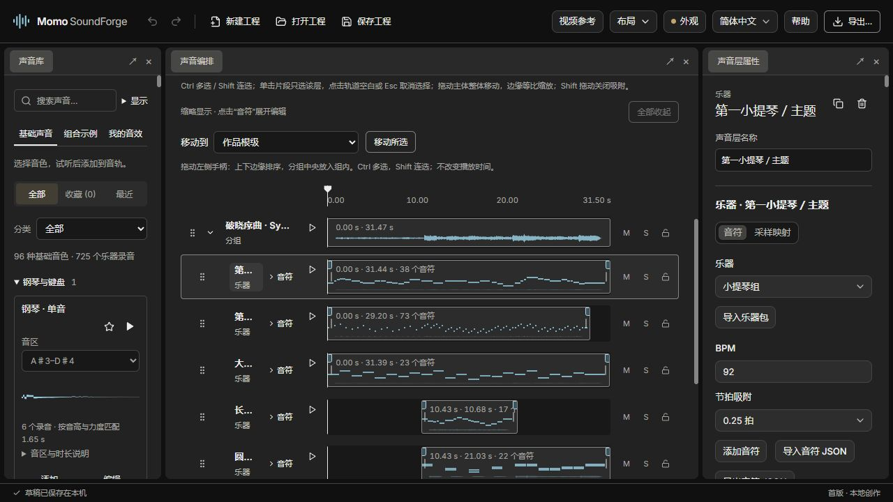

# Momo Sound Forge

<!-- doc-language -->
[简体中文](README.md) · [English](README.en.md)
<!-- /doc-language -->

在浏览器中制作游戏音效和短旋律：挑选基础声音、组合音轨、编辑音符，再导出可用于游戏的音频。面向不熟悉音效制作的开发者，从可试听的声音和组合示例开始，也能继续精细调整。

**[在线使用（GitHub Pages）](https://breezymomo.github.io/MomoSoundForge/) · [使用手册](docs/user-guide.md) · [乐器与音符](docs/instruments.md) · [开发与部署](docs/development.md)**

无需账号，合成、混音和导出在浏览器本机完成。内置音源按需下载；导入的音频、视频与自己的工程不会上传到服务器。草稿和「我的音效」保存在当前浏览器，跨设备使用请下载工程文件。



> 左侧选择基础声音或组合示例，中间编排与试听，右侧编辑音符和声音参数。

## 可以做什么

- **游戏音效**：从确认、拒绝、拾取、命中、激光、蓄力、挥动和爆炸预设开始，搭配碰撞、液体、布料等实录采样。
- **基础声音库**：115 种基础音色，包含 48 种乐器与演奏法、59 种 CC0 音效和 8 个合成预设。乐器使用 725 个不同录音，音效使用 106 个不同录音；支持搜索、试听、收藏、音区与录音选择。
- **乐器与短旋律**：钢琴、弦乐、木管、铜管和打击乐；按拍编辑音高、时值与力度，使用采样映射匹配音域、力度层和演奏法。
- **多轨编排**：片段移动、多选整体拖动、边界缩放、非破坏裁切、淡入淡出、静音和独奏。乐器轨道默认显示音符缩略图，需要时展开钢琴卷帘。
- **组合与复用**：节点分组、嵌套工程、可编辑组合示例和本地声音库；通过组合控件统一调节多个参数。
- **声音修饰**：音色、回声、空间感，以及音量、声像、低通的自动化曲线；可对比修饰前后的声音。
- **变化与循环**：固定种子生成五个可重复的变体，锁定需要保留的声音层；循环区域、交叉淡化与接缝试听。
- **视频参考**：导入本地视频，按帧定位并添加标记，配合时间轴制作同步音效。
- **自定义工作区**：面板停靠、布局保存、主题和中英文界面；切换编排、音符等任务布局。
- **交付与备份**：WAV、OGG、MP3、FLAC、批量变体 ZIP，以及内嵌所用采样的 `.soundforge` 可编辑工程。

SoundForge 在 Workbench 中注册专属主题“声夜 · 紫蓝”：近黑工作区、低饱和暗紫面板、紫色主要操作与青蓝色调节控件。新安装默认使用该主题；已有外观偏好会保留，可从顶部“外观”手动选择，原有七种共享主题仍可用。产品只提供主题数据和文案，菜单、弹窗、控件结构与交互继续复用 Workbench。切换主题只重绘波形显示，不重新生成或改变声音。

## 第一次使用

1. 打开左侧 **基础声音**，搜索或试听一个声音，点 **添加** 放入当前作品；点 **编辑** 可单独打开它。
2. 在中间拖动声音片段，调整各层出现的时间。点击轨道旁的试听按钮可单独听这一层。
3. 选中声音，在右侧调整参数；乐器轨道点击 **音符** 展开编辑，也可在右侧添加音符或导入音符 JSON。
4. 点击 **试听** 检查整个作品；需要保留余韵时，使用 **扩展到内容末尾**。
5. **保存工程** 保留可编辑结构和采样；**导出…** 生成用于游戏的音频。

**基础声音**用于搭配自己的音轨，**组合示例**用于体验和拆解完整效果，**我的音效**保存自己调好的可复用声音。添加到作品的是独立副本，修改它不会改变库中的原件。

## 常用操作

- **Ctrl / Cmd 点击**增减选择，**Shift 点击**连续选择同级轨道。
- **单击片段**只选这一层；**点击轨道空白或按 Esc**取消选择。拖动过程中按 Esc 则取消当前拖动。
- 拖动已选片段整体移动多条轨道，到作品边界时停住并保持间距；按住 **Shift 拖动**临时关闭吸附。
- 点击 **音符**或双击乐器片段展开钢琴卷帘，**全部收起**返回紧凑视图。
- **Ctrl / Cmd + Z** 撤销，**Ctrl / Cmd + Shift + Z** 重做，**Ctrl / Cmd + S** 保存工程。

片段边缘缩放会同时改变速度与音高。音符的「拍」由 BPM 换算为秒：120 BPM 时，1 拍为 0.5 秒。裁切、自动化、循环、组合控件及导出设置见[使用手册](docs/user-guide.md)。

## AI 创作

顶部「AI 工具」提供内置创作 Skill，可连接自己的 AI 客户端，查询声音库、写旋律、修改节点并试听。包含原生离线工具与带来源记录的音效检索流程，详见 [AI 创作与素材检索](docs/ai-authoring.md)。

MCP 还支持候选变体生成、试听与应用，声音修饰与原声对比，各级嵌套组合控件，以及与导出面板共用的 WAV/OGG/MP3/FLAC 设置和批量 ZIP。候选先展示供试听，应用可撤销；用户修改后旧候选写入会被拒绝。

## 文档与示例

- [使用手册](docs/user-guide.md)：声音库、时间轴、分组、处理、保存、导出与视频参考。
- [乐器与音符](docs/instruments.md)：采样音域、力度层、演奏法、音符 JSON 和便携乐器包。
- [长笛示例](examples/instruments/flute/)：可编辑工程、乐器包和音符数据。
- [开发与部署](docs/development.md)：本地运行、资源构建、验证与 GitHub Pages。
- [产品目标](docs/product-vision.md)：面向非专业游戏开发者的设计方向。

当前支持多声部音符编辑；尚未提供实时 MIDI 输入、VST 插件宿主、语音生成或在线 AI 生成服务。专业模式属于后续方向。乐器的真实音域、演奏法和可持续时长受现有采样限制，不会自动补出未录制的演奏法。

## 本地运行与部署

开发需要 Node.js 22 或更新版本。

```sh
npm ci
npm run dev
```

打开终端显示的地址，默认 `http://127.0.0.1:5180/`；Windows 也可以双击 `start.bat`。固定版本的 MomoWorkbench 包含在 `vendor/`，无需克隆其他 Momo 工程。

```sh
npm test
npm run build
node tools/check-static-site.mjs
npm run preview
```

`dist/` 是完整的多文件静态网站，需通过 HTTP/HTTPS 提供服务。当前不提供双击即用的单文件离线 HTML。GitHub Actions 在推送 `main` 后自动测试、构建并发布；构建产物不提交回仓库。站点、本地端口与其他部署地址的浏览器草稿不会自动互通。

## 素材与第三方组件

内置采样使用 CC0 素材，来源和许可随声音库分发；原始记录保存在 [samples/](samples/)。自行导入的素材仍遵循其原许可。第三方音频编码器的版本、许可和源码出处见 [THIRD_PARTY_NOTICES.md](THIRD_PARTY_NOTICES.md)。

新增游戏音效包按 19 种用途整理了 66 个录音，覆盖脚步、落地、命中、门与机关及刀刃动作，附带 8 个可编辑组合；来源、许可及处理记录见[采集说明](samples/game-sfx-starter-20261105/使用说明.txt)。

## 反馈

反馈时请附上复现步骤、浏览器版本、截图，以及可以分享的最小 `.soundforge` 工程。[GitHub 仓库](https://github.com/BreezyMomo/MomoSoundForge)和仓库内文档的访问权限以仓库设置为准。
