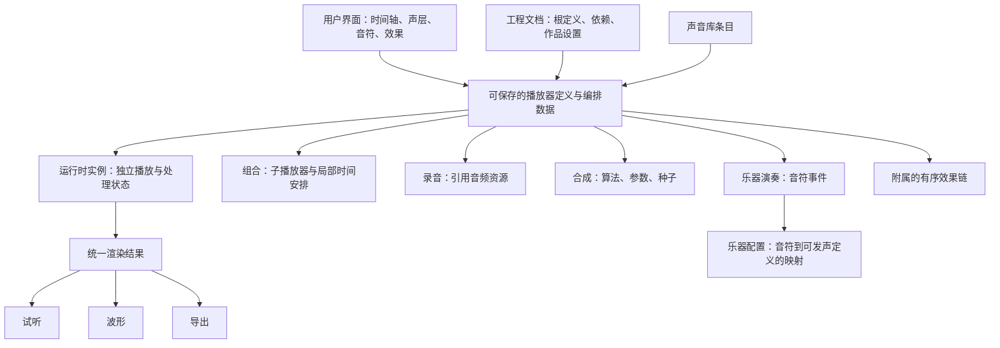

# 播放器架构讨论草案

整理日期：2026-11-06。讨论起点：`bb260ff`，分支：`codex/player-architecture`。

**状态：讨论记录，核心规则已在本分支落地。** 用户已授权开始开发。本文保留当时的推导和待定问题，当前字段、已经实现的规则与明确限制以 [实现说明](sound-design-plan.md) 为准；下文的“待定”不代表仍需重复向用户确认。

本轮已确认：播放器提供自身输出时长；父播放器通过子项记录管理开始位置、读取范围、速度和循环；时间轴声层展示这项使用关系；替换只更换子播放器，保留使用设置。替换后的读取越界补静音并提示，循环保持原读取范围，由用户主动选择适配。播放器输出时长默认包含完整尾音，父级显式裁剪则按边界截断。单独保存一层默认保留该层及其使用设置，不带父组合效果。

产品取舍遵循 [产品目标](product-vision.md)。当前原生格式为 `momo.soundforge/v4`，具体结构见实现说明。本文中的更远期能力不能自动视作已实现。

## 1. 要解决的问题

现有讨论混合了几种不同维度：

- 声音从哪里来：录音、程序合成。
- 如何发声：直接读取片段、按乐谱触发乐器。
- 如何组织：多个声音在时间轴上排列、叠加、组成可复用声音。
- 如何保存：工程文件、声音库条目、资源依赖。

这些维度都曾被装进“音源”“声层”“组合”等词中，导致更换内容、保存和再次引用的含义难以解释。尤其是把一个工程再次作为子工程插入时，容易因为保存容器和组织容器混用而增加没有创作意义的层级。

新方案希望让底层职责统一，同时保留用户熟悉的分层编辑方式。目标仍然是帮助不懂音频的游戏开发者做好基础音效，而不是让用户学习节点图和更多术语。

## 2. 当前倾向

1. 用统一的“播放器”抽象表示能够产生声音的对象，组合本身也可以是播放器。
2. 播放器的具体类型负责决定声音的来源或组织方式。
3. 用户仍通过时间轴、声层、音符、效果等直观界面编辑，不要求直接操作底层图。
4. 乐器是音符到声音的映射配置；乐器演奏播放器负责按乐谱使用这份配置。
5. 普通后处理作为播放器上的有序效果链，避免每加一个效果都产生一个可见嵌套层。
6. 播放器定义、运行时实例和编辑器界面状态分离。
7. 保存与重复引用应保持声音和有意义的结构，不能仅因为“又保存了一次”就多套一层。

Unity 的 PlayableGraph 与 Timeline 关系是理解这个方向的类比：底层负责执行，时间轴提供创作表达。这不意味着迁移到 Unity，也不意味着需要照搬其 API 或类继承结构；TypeScript 中具体使用接口、组合还是继承另行决定。

前面讨论过的两个极端不作为当前目标：一是把每个滤波、音量、回声都保存为嵌套播放器；二是因为底层统一，就从用户界面删除“层”。

## 3. 概念与职责

### 播放器定义

可序列化、可保存、可复用的声音描述。它说明如何生成声音，不包含当前播放到哪里、延迟缓冲里有哪些采样等运行状态。

候选的基本类型：

- **录音播放器**：引用音频资源，从中读取声音。
- **合成播放器**：保存合成算法标识、参数和随机种子，生成声音。这里的“公式”不表示允许直接执行外部任意脚本。
- **组合播放器**：安排多个子播放器在自身局部时间轴上的播放，并混合输出。
- **乐器演奏播放器**：引用乐器和音符事件，触发并混合演奏声部。

“给一个时间，返回声音”是职责上的理解方式。实际渲染通常请求一段音频帧，还需要采样率、渲染上下文和状态，不能把所有类型都实现成不依赖历史的单点函数。

### 乐器与音符

乐器保存“什么音符、力度、演奏方式应该调用什么声音”的配置。映射可能包含原始音高、允许音域、力度区间、移调、校准音量、释音以及重复录音选择等信息。

音符是演奏事件，包含音高、开始时间、持续时间、力度等信息。**音符本身不是普通录音；使用录音演奏音符，也不使乐谱变成音频文件。**

当前内置乐器主要使用录音资源。新架构可以为合成器驱动的乐器预留空间，但不能未经设计便允许任意组合或另一个乐谱播放器充当乐器音色：必须明确音高、触发、释音能力，并防止递归引用。

### 运行时播放器实例

根据定义创建，负责实际发声。每次独立使用需要自己的播放状态、音符声部状态、滤波器状态和回声缓冲。

同一个定义被使用两次，可以共享不可变的音频数据，但不能共享可变的效果或演奏状态。保存工程保存定义及依赖，不保存运行时缓冲。

### 时间轴与声层

声层是用户编辑和组织声音的方式。某一行可以对应组合播放器的一路输入或一个可编辑分支；内部效果不必各占一行。

已确认：叶子播放器没有子播放器，仍可独立生成声音、试听和计算波形，但不能作为没有父级管理的时间轴项直接编辑。裸录音或合成音进入编辑流程时建立必要的父播放器；时间轴中的一行展示子播放器，并编辑父播放器对子项的使用设置。编辑根本身不必额外显示成一行，不能把每个父节点机械地映射为一个可见声层。

真实的编排数据必须保存：例如第 2 秒开始、读取哪段声音、是否循环。这些不是临时界面状态。反过来，展开折叠、当前选中项、面板位置等界面偏好不进入声音工程与撤销记录。

应只有一份权威声音数据。时间轴操作修改创作数据，再由其建立运行时图；不要另建一套独立的 Layer 参数和一套播放器参数，靠双向同步维持一致。



## 4. 左侧声音库展示什么

当前倾向是让声音库条目代表**可复用的播放器定义**，而不是正在播放的实例，也不是必须包着一个完整工程的容器。

- 雨声条目可以对应一个录音播放器定义。
- 激光条目可以对应一个合成播放器定义。
- 爆炸条目可以对应包含冲击、碎片和尾声的组合定义。
- 保存的旋律可以对应一个乐器演奏定义，连同所需乐器配置和资源一起复用。

它们都可以被试听、加入作品和继续编辑。界面名称可使用“声音”等容易理解的词，“音源”是否作为统一名称仍待决定。

乐器配置用于选择“用什么演奏”，与一个已经带乐谱的可试听声音不是同一件事。界面需要支持创建乐器演奏以及切换乐器的清晰入口，但左侧是否按“声音／乐器／示例”分区、使用哪些标签和筛选，尚未定稿。

定义在库中的来源、分类、收藏等检索信息，不应变成新的声音生成类型。也不重新引入用户难以理解且收益不明确的“配方”概念。

## 5. 第 2 秒开始，数据放在哪里

一个声音在父组合中的开始位置属于**这次使用的编排信息**，不属于音频文件本身。

以下仅用于说明职责，不是已经确定的新格式：

```json
{
  "id": "rain-placement",
  "playerId": "rain-with-echo",
  "start": 2,
  "sourceStart": 0,
  "sourceEnd": 8,
  "speed": 1
}
```

- `start`：在父组合的局部时间轴上从何时开始。
- `sourceStart`、`sourceEnd`：读取子播放器局部时间的哪个区间。
- `speed`：这次使用的播放速度，示例暂只考虑正数。

在有效播放区间内，非循环时的映射为：

```text
childTime = sourceStart + (parentTime - start) × speed
```

所以父组合播放到 3.2 秒，示例读取子播放器的 1.2 秒。父组合中的一项编排记录不必因此变成一个额外的声音播放器类型。

嵌套组合使用相对时间。例如外层组合在作品第 5 秒开始，其内部声音在第 2 秒开始，单位速度时该声音从作品第 7 秒开始。

**已确认：** 开始位置、读取范围、速度和循环属于父播放器中的子项记录，不再另设一份含义重复的“子播放器自身默认裁剪”作为第二控制源。这一规则适用于所有子播放器，包括组合，不仅适用于叶子。同一播放器被使用两次时，两条子项记录可以具有不同设置。

每个播放器对外提供自身输出时长；父级子项另行描述读取范围和本次播放长度。例如雨声自身长 8 秒，父级读取其中 3 秒，循环占用 10 秒，三者不能混用一个时长字段。组合默认按子项推导输出时长，合成声音需要明确的有限生成长度。

已确认：播放器自身输出时长默认包含回声、混响等完整尾音；父级明确裁剪其输出时，则在裁剪边界停止读取，不自动延长这次使用。父播放器自身效果仍可以在子项结束后产生自己的尾音，不能把截断子级输出理解成同时清空父级效果。尾音结束的数值阈值、计算上限等引擎细节，以及作品窗口与导出长度的关系仍需设计。

## 6. 裁剪与循环

### 裁剪保持怎样的声音

对于一个原本在父时间 2 秒开始、读取子时间 `0～8` 秒、速度为 1 的片段：

1. 左边向右裁剪 1 秒：`start = 3`，读取范围变为 `1～8`。剩余声音在父时间轴上的位置保持不变。
2. 再把右边裁掉 2 秒：读取范围变为 `1～6`。片段持续 5 秒，在父时间第 8 秒结束。

一般正速度下，裁掉父时间上的 Δ 秒，读取端点变化为 `Δ × speed`。非循环、没有额外尾音语义时，默认长度为 `(sourceEnd - sourceStart) / speed`。

拖动片段主体改变父时间位置；普通边界裁剪不应偷偷变成拉伸变速。拉伸需要明确的独立操作。

### 循环需要区分两个范围

- **源读取范围**：每轮读取子播放器的哪一段。
- **父时间占用范围**：这个声音在作品中持续多久。

例如在父时间第 2 秒开始，循环读取子时间 `1～4` 秒，速度为 1，总共播放 10 秒：每轮 3 秒，最后一轮只读 1 秒，在父时间第 12 秒结束。

```text
window = sourceEnd - sourceStart
childTime = sourceStart + ((parentTime - start) × speed) mod window
```

这只描述循环的取样位置，不描述效果状态如何处理。启用循环后，拖动片段右边通常应调整总持续时间，源循环范围需要另一个明确入口。

声音自身的循环参与工程保存与导出；顶部“循环试听”属于播放控制，不能把二者混成同一个声音参数。试听范围是否作为可恢复的会话设置保存另行决定。

### 裁剪、循环与效果的顺序

裁掉雨声输入再加回声，可以留下回声尾音；裁掉已经含回声的完整输出，则会把尾音一并截断。这两种操作不能用同一份含糊参数表示。

同样，重复读取干声、让回声连续处理，与循环播放一段已经渲染过回声的成品，会得到不同结果。循环也不天然等于无缝，需要另行考虑接缝处理。

已确认的父子关系提供了处理顺序：父级子项读取的是子播放器的完整输出，包含子播放器自身效果；读取、裁剪、循环后的子项声音混合，再进入父播放器自身效果。效果挂在雨声上时，父级裁剪带效果的雨声；效果挂在父级时，则先裁剪、循环雨声，再处理父级效果。不必为每次裁剪和循环默认新增 `TrimPlayer`、`LoopPlayer`。具体尾音长度、循环接缝和有状态效果的渲染策略仍需细化。

## 7. 效果作为播放器之后的处理链

最新讨论倾向：**少量播放器类型 + 明确的播放设置 + 有顺序的效果列表。**

示意结构如下，字段名与参数仅为表达思路：

```json
{
  "type": "audio",
  "assetId": "rain-audio",
  "effects": [
    { "type": "filter", "cutoff": 3000 },
    { "type": "delay", "interval": 0.2, "amount": 0.3 },
    { "type": "gain", "value": 0.8 }
  ]
}
```

这是一个播放器和三个处理步骤，不是四层嵌套播放器。音量是否作为常用固定字段、效果项，或映射到统一处理阶段，仍需确定，避免重复设置含义不清。

典型处理顺序可以理解为：

```text
子播放器各自生成声音 → 各自效果 → 父级按子项设置读取、裁剪、变速、循环与定位 → 混合 → 父播放器自身效果 → 输出
```

子播放器上的效果改变该声音；组合上的效果处理混合后的整体。效果顺序必须保存，通常不能随意交换。例如各层先失真再相加，与相加后整体失真不同。

“效果没有独立时间轴”不等于“效果不需要时间和状态”：

- 回声、混响需要历史声音；滤波器也可能具有内部状态。
- 参数自动化需要知道当前时间和其所属坐标系。
- 输入停止后仍可能有尾音，不能一律立刻停止效果处理。
- 跳转、离线渲染和循环时，需要明确重置、预渲染或缓存策略。

运行时可用音频块接口处理这些问题，例如局部开始时间、帧数、采样率和上下文。具体接口尚未确定。不要为了“给时间就返回声音”的抽象，假装带回声的声音可以无状态地随机取样。

## 8. 保存、再次引用和嵌套

### 工程是文档容器

工程保存根播放器定义、依赖的播放器与乐器配置、音频资源，以及作品时长等必要创作设置。工程文件本身不自动成为图中的另一个播放器。

保存根声音 A，再把 A 放入新作品时，添加的是对 A 的一次使用。如果 A 是组合，它原有的内部结构仍存在；不能因为它经过工程文件保存，就再自动增加一个没有作用的组合。

已确认：必要的父播放器在开始编辑时建立，而不是保存时临时增加。保存保留已有结构；打开已保存的声音恢复原结构，不再次包装。将它加入另一个作品时，由新作品的父播放器管理这次使用，原本有意义的内部编排继续保留。

### 保存一个声音与保存组合

- 保存单个编辑分支，需要保留它的声音内容、有效裁剪、循环、速度、效果与自动化等声音语义。
- 它在原父组合中“第 2 秒开始”的位置通常不属于单声音资产。
- 保存一个组合，需要保留其子声音之间的相对位置和组合自身处理。
- 保存多个选中声音时，时间原点如何归一化，以及是否包含父级效果，需要明确规则，不能隐式遗漏或重复处理。

已确认：从组合中单独保存一层，默认保存该层引用的播放器及其使用设置，不带原父组合的效果。被保存的子播放器自身效果、内部组合及其内部效果仍需保留。父组合效果处理的是多路混合结果，复制到单层并不等价；因此单层保存不承诺复现它在原组合整体处理后的听感。

父级子项记录是裁剪、循环、速度的唯一归属。保存完整编辑根时，这些记录随父播放器自然保存，不需要转换成叶子的属性。局部保存仍需细化：从较大的组合中抽出一项时，如何选取或建立必要的父结构及归一化外部位置。不得为携带使用设置而顺便复制已确认排除的父级效果，也不能重新引入另一套裁剪参数。

### 层级只表达真实结构

真实的混音、独立编排和有意义的处理边界可以产生嵌套。只有一个子声音的组合也可能有意义：它可能有整体效果、裁剪或控件，不能仅凭“只有一个孩子”就删除。

可以规范化完全中性的容器，但前提是声音、时间、效果顺序、自动化和编辑语义都等价。减少层数不能靠破坏声音来实现。

期望的不变量是：**保存和重新打开不额外增加包装；反复加入和保存不产生无意义包装。** 加入新作品形成新的真实编排或处理边界时，可以合理增加父级，不能为了层数不变而随意压平。中性重复包装的规范化规则仍需细化。资源和实例标识可以调整，但固定种子对应的声音不能因此变化。

### 复用不等于共享运行状态

推荐默认让新作品中的声音可独立编辑，避免修改一个作品时悄悄改变其他作品。底层采用复制快照还是写时复制，尚未决定；需要联动更新的引用模式也未承诺实现。

资源可以去重，定义可以被多处使用，但每次播放的可变状态必须独立。图结构和乐器映射都需要禁止循环依赖，并校验嵌套深度、节点数量、音频资源、声部数量和渲染预算。

## 9. 已确认的替换规则

替换修改父播放器中某个子项所引用的播放器，不替换这条使用记录。示例：

```text
替换前：父播放器 → 子项（第 2 秒开始，读取 1～4 秒，速度 1，循环播放 10 秒）→ 雨声
替换后：父播放器 → 同一子项（使用设置保留）→ 风声
```

- 保留父级子项的开始位置、裁剪范围、速度、循环和播放长度等使用设置。
- 子播放器内部的声音、子结构、乐谱和自身效果随替换改变，采用新播放器的内容。
- 父播放器自身效果不受影响。
- 替换乐器演奏播放器意味着替换其乐谱和乐器；在原演奏播放器内部“切换乐器”是另一种操作，其音域等细节仍待定。

### 新播放器长度不足

已确认的交互原则：保留原设置意图，明确提示读取范围超出新声音长度，并提供“适配新声音长度”的主动操作，不静默重置裁剪或拉伸声音。例如原来读取 `1～4` 秒，新声音只有 2 秒，需要显示这种不匹配。

已确认：适配前，超出新播放器输出时长的读取部分返回静音；子项的位置、播放长度、速度和请求的读取范围保持不变，并提示“部分范围超出声音长度”。循环仍按原读取范围和周期循环，范围内越界的部分补静音；若请求范围全部超出，则该子项读取结果为静音，不暗中缩短循环或暂停时间推进。

例如仍读取 `1～4` 秒，新播放器只有 2 秒，速度为 1 时，每轮先读取有效的 `1～2` 秒，再播放 2 秒静音，循环周期仍为 3 秒。静音是这次读取的结果，父级效果仍按正常处理链运行，已有回声等状态不会因此强制清空。

此处保留的是用户请求的范围，不允许渲染器非法访问音频数据，也不豁免对负数、非有限值、零长度循环等无效参数的校验。**待定：** 用户主动执行“适配新声音长度”时，起止范围和播放长度具体如何调整。该算法尚未决定，不能用自动适配代替已确认的越界静音行为。

## 10. 实现前要继续定下来的问题

按依赖关系优先讨论：

1. **局部保存细节**：单层默认保留其使用设置并排除原父组合效果已经确定；必要父结构、时间归一化、中性包装规范化，以及多项选中保存的范围规则仍需设计。
2. **处理细节和时间坐标**：父级读取子级完整输出、混合后处理自身效果的顺序已经确定；包络、音量、声像及自动化的具体归属和时间坐标仍待定。
3. **时长计算与导出**：默认包含完整尾音、父级显式裁剪截断子级输出已经确定；尾音计算阈值与上限、时长字段以及作品窗口与导出长度的关系仍需设计。
4. **乐器演奏边界**：音符时长、释音、移调和音域约束；切换乐器后超出音域的音符怎么办；乐谱节拍与秒的换算属于哪一级。
5. **保存与依赖格式**：树还是带引用的图、快照还是链接、资源去重、稳定随机种子、多个选中声音保存时的范围规则。
6. **主动适配算法**：替换后保留设置、越界补静音、循环保持原范围和周期已经确定；“适配新声音长度”如何调整范围及播放长度仍需设计。
7. **编辑器映射**：一行可容纳几个片段，分组如何对应组合，库条目的名称和筛选方式，以及哪些内部结构需要对用户展示。

这些问题不能通过先写一套字段再强行解释来解决。先用具体创作案例验证行为，再固定序列化格式和运行时接口。

## 11. 后续改造边界与验收场景

本分支已开始实施。用户明确项目尚未发布，不要求旧工程兼容；但**内置资源、示例、生成脚本和交付流程必须同步处理**，不能留下旧结构或改变原有声音而不说明。

建议用以下场景验证方案，再据此安排实现：

- 从库中加入录音、合成音、组合和旋律，均可试听、编辑、保存并再次使用。
- 一段声音在第 2 秒开始，裁剪左右、移动和变速的结果符合明确的时间映射。
- 循环读取 3 秒素材共 10 秒，末轮截断正确；全局循环试听不会改变导出声音。
- 输入裁剪与输出裁剪、持续处理回声与循环已处理输出，产生可解释的不同结果。
- 同一声音被同时使用两次，效果和音符状态相互独立。
- 多次保存和重新加入，结构不会无意义地增长，声音保持一致。
- 修改副本不会意外修改库中原件或其他作品；资源仍可携带和去重。
- 换乐器保留乐谱的规则明确，换素材和换整个分支的保留规则明确，操作可以撤销。
- 替换子播放器保留父级使用设置和父级效果，不残留旧子播放器内部内容；新声音过短时明确提示，不静默改写范围或变速，“适配新声音长度”由用户主动触发。
- 越界读取补静音，循环仍按原范围和周期运行；部分越界和全部越界均不越界访问资源，不改变子项时间安排。
- 播放器输出默认包含自身效果尾音，父级显式裁剪能截断子级完整输出；父级自身效果的尾音按自身规则继续处理。
- 单独保存一层保留子播放器自身内容、效果及其使用设置，默认不带原父组合效果；完整保存组合仍保留该组合自身效果。
- 固定种子、不同音频块大小以及规定的跳转策略产生一致结果；试听、波形和导出使用同一渲染结果。
- 内置资源全部通过新格式校验，异常引用、循环依赖和超预算输入得到可理解的错误反馈。

实现后按项目要求运行 `npm test`、`npm run build`，交互变更检查真实浏览器，声音变更进行实际试听。验收依据是用户能否更容易完成创作与复用，而不是播放器类型是否足够“统一”。
