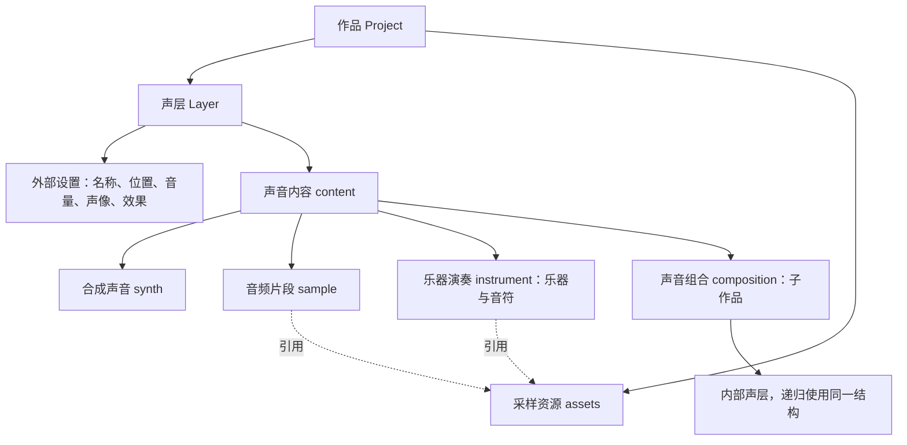

# 作品、声层与声音内容

更新：2026-11-06。按用户要求调整原生结构，不兼容尚未发布的旧工程格式；内置资源及生成流程同步更新。

## 结构与职责

原生工程为 `momo.soundforge/v3`。Layer 保管 id、name、start、duration、gain、pan、muted、solo、locked、effects、automation；content 保管 type、波形与种子、素材引用、乐谱或子作品、内容控件值，以及速度、包络、裁切、滤波、失真等内部设置。duration 是声层展示和播放的时长；组合时长由内部内容推导，更换后重新计算。作品窗口仍由用户控制。

content.level 是内容自身的电平系数，默认 1。录音候选的预设电平归入这里，不覆盖目标声层音量。组合保留子作品自己的混音、效果、资源、种子与控件；外部声层效果随后处理一次。

自动化仍用参数名映射：gain、pan 属于外部，cutoff 指向内容滤波。更换内容只保留 gain、pan 曲线。组合控件也沿用参数名，通过统一读写函数找到实际字段。makeLayer 的扁平参数只是内部构造简写，保存的工程始终使用嵌套 content，不是旧工程兼容层。

合成与采样是发声方式；乐器演奏与声音组合是内容组织方式，不能混为同一套音源分类。目前乐器使用多采样录音，音符是演奏数据。

## 编辑与更换

属性顶部提供「编辑内容」「更换内容」。编辑组合进入子作品；其他内容定位到参数或音符编辑区。外部设置和声音内容分区展示。

任何声层可以整体换成音频片段或声音组合，包括组合与采样互换。候选来自内置录音、内置组合示例、当前组合采样及本地音频。本轮没有新增合成／乐器候选选择器、保存库候选或「合成为音频」。

- 保留目标声层 ID、名称、位置、音量、声像、静音、独奏、变体锁定、外部效果及音量／声像自动化。
- 完整换入候选内容；旧子声层、音符、合成参数、源范围、裁切与拉伸均不沿用，候选自身的内容设置保留。
- 保留父组合对目标 start、gain、pan 的绑定；解除指向旧内容参数或旧子控件的绑定，即使新内容恰好使用相同控件 ID。确认前显示数量。其他声层和绑定不变。
- 分配独立采样资源 ID，避免影响共享素材的其他声层。组合携带自己的资源作用域；保存清理不用的资源。
- 作品窗口保持原长，面板显示声层时长变化及超出窗口的说明。最外层作品不是可选声层；整体更换多个声层前先编组。
- 变体锁定只约束随机生成，不阻止主动更换。

候选在完整作品中试听；取消不写工程，确认只产生一次编辑，撤销恢复内容、参数、资源和绑定。关闭、停止加载或工程变化时防止过期结果覆盖新状态。预览和确认共用 replaceContent；试听、波形、导出共用渲染器。输入继续校验结构、采样数值和资源预算。

## 内置资源与 AI 创作

仓库中的原生示例、乐器演示、采样工程和生成器均使用 v3。内置目录重建压缩文件、哈希、字节数与波形；原录音数据、ID、来源和许可保持不变。AI 编辑内容参数放在 patch.content，外部参数仍在 patch。普通 patch 不能改变内容类型或资源身份。

## 产品边界

不保留独立「配方」。木质、金属、身体命中作为普通组合示例，快捷调整使用组合控件。预设是起点，声音库是存取入口，不是新的音源或工程类型。候选池、受约束变体、实时演奏、专业模式和声音固化仍属后续方向。

## 验证

运行 npm test、npm run build，检查浏览器里的跨类型更换、对比、取消、确认、一次撤销和窄窗口。比较改造前后全部内置资源的渲染 PCM 指纹。自动测试不代替主观听感验收。
