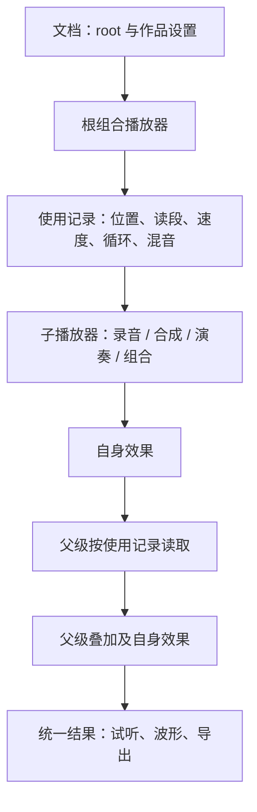

# 播放器、使用关系与编辑器

更新：2026-11-06。本分支实现 `momo.soundforge/v4`，不兼容尚未发布的旧格式。产品原则见 [product-vision.md](product-vision.md)，讨论来历见 [player-architecture-discussion.md](player-architecture-discussion.md)。本文描述当前实现，是后续 AI 修改代码时的结构依据。

## 权威结构

原生文档保存 `schema/name/duration/root`，可附带视频参考和全局循环范围。`root` 是播放器定义，不是另一份可播放工程。定义只保存声音数据，不保存播放位置、面板状态或处理缓冲。

- `Player`：录音 `sample`、合成 `synth`、组合 `composition`、乐器演奏 `instrument`；自身参数和 `effects` 随播放器保存。
- `PlayerInput`：父组合的一次使用，保存 `player` 和 `start/duration/sourceStart/sourceEnd/speed/loop/reverse`，以及名称、音量、声像、静音、独奏、变体锁定、自动化。
- `Player.mix.inputs`：组合安排子播放器的使用记录。先读取并混合子输出，再处理组合效果。
- `score.instruments`：乐器录音映射；`score.notes`：音符事件。当前仍是经过验证的多采样乐器，不开放任意播放器递归充当乐器音色。
- `assets`：最近一层组合持有的可携带录音资源；保存剔除不用的资源，复制到新的作用域时重映射资源 ID。

编辑器中的 `Project` 类型是根混音配置的编辑视图；`makeLayer` 是创建 `PlayerInput` 的内部简写。没有第二套 Layer 声音数据。原生文档经 `projectDocument` 输出、`parseProject` 校验后成为编辑视图，保存入口共用这些函数。

## 合成器、乐器与声音实例

顶栏“合成器与乐器”管理独立定义。合成器定义 `momo.synth/v1` 保存可信算法标识和默认参数；当前支持 `oscillator-v1` 一种算法。合成播放器携带 `player.synth` 定义快照，实际渲染使用播放器自身参数，可与定义默认值不同。

乐器定义 `momo.instrument/v1` 保存单个乐器的录音映射和便携资产，不保存音符。创建乐器播放器得到空谱；旋律写在 `score.notes` 中，定义快照放在 `score.instruments` 中，录音放最近组合资产里。定义库与声音库、作品撤销记录分开，修改定义不联动已有作品。

同类型“选择合成器／乐器”保留父使用关系、自身效果和时长；选择合成器应用默认参数，选择乐器保留音符并重新绑定所选单一乐器。它不同于整体“更换内容”。操作、模块与限制见 [定义编辑器交接](handoff-sound-definitions.md)。

## 时间规则

`start` 是父级秒数；`duration` 是本次播放占用的秒数。`sourceStart/sourceEnd` 是子播放器完整输出上的半开区间，单位秒。`speed` 是父时间到子时间的倍率，变速也改变音高。`player.duration` 是叶子主体时长；组合主体按其混音窗口与内部输入终点计算。

本次使用局部时间为 t，正向读取位置为 sourceStart + t * speed。循环先对读段长度取模；倒放从终点的最后一帧向前读。播放占用范围外不发声；请求读段内超出子输出的部分为静音。全局循环试听与输入循环独立，前者不修改导出音频。

默认读取完整子输出，包括自身尾音。效果尾音按衰减阈值估计、每条效果链最多 4 秒，达到边界仍有明显信号时淡出并提示。父级明确裁剪可截断子尾音，父级自己的效果继续处理。作品窗口是独立的最终试听/导出范围，可显式延长。

输入增益/声像及其自动化在读取后执行，曲线时间按本次占用归一化。合成/采样包络、滤波、失真属于播放器；目前 cutoff 自动化仍保存在输入的参数曲线容器中，但按源主体时间执行，替换内容时移除。效果保持既有音色→回声→空间的固定顺序，不是可自由排序的插件系统。

## 编辑与替换

用户仍操作声音层和音符。四类播放器都可裁剪、变速、循环、倒放。变换过的组合不在外层平铺内部时间轴，通过“编辑内容”进入；内部游标使用同一时间映射。暂不允许跨经过时间变换的组合边界搬动内部声层，避免错误换算；组内排序不受影响。

更换只换输入的 `player`：保留位置、请求读段、速度、循环、播放长度和外部混音设置；新播放器带来自己的内容、子结构、乐谱和效果，旧播放器效果不会残留。父组合效果不变。原内容参数绑定与 cutoff 曲线解除，start/gain/pan 绑定保留。

新声音太短时提示越界，不静默变速或改周期。“适配新声音长度”把终点收至新输出终点；原起点仍有效则保留，否则归零。非循环重新计算占用时长；循环保留占用时长。预览与确认共用逻辑，取消不编辑，确认一次撤销恢复。

## 保存、声音库与重复引用

声音库保存可复用声音快照，显示名称、分类和试听，不要求用户理解底层播放器类型。加入后是独立副本，修改不联动原件。根叶子进入编辑器时建立必要父组合，保存/打开不再加一层。

单独保存一层把本次使用起点归零，保留读段、速度、循环、子播放器和自身效果，排除原父效果。复用只有一个输入、起点零、无父效果/控件/主音量变化且窗口恰好覆盖输入的中性根时，直接复用该使用记录。多路混音、额外留白和真正的处理边界保留。

固定种子属于播放器，输入 ID 和父组合种子不改变原声音。每次渲染的相位、滤波、回声、音符状态独立。当前是完整有限缓冲渲染，不是无限流式实时引擎。

## 资源与 AI 接口

内置原生工程、示例、生成器同步迁移 v4；原录音、许可和来源保留。旧版按输入 ID/父种子推导的随机值在迁移时一次性固化进播放器。目录压缩文件、哈希、字节数和波形重新生成。

AI capture 返回编辑视图 `inputs[].player`；参数修改用 `patch.player`。`duration` 修改播放占用，`player.duration` 修改源主体，两者不能混用。组合路径沿 `player.mix.inputs`；谱面用 `player.score`。普通 patch 不允许改 type/assetId/mix，插入完整声音用 insert。

每级 16 路输入、6 级嵌套、总计 128 路输入，资产和音符共享预算；拒绝无效数值、空读段、旧版本和循环依赖。音频分配预算独立于创作时长，超预算报错。

不新增独立配方。专业模式、自由效果排序、合成乐器映射、实时流式运行、联动引用是后续能力，不能描述为已实现。
